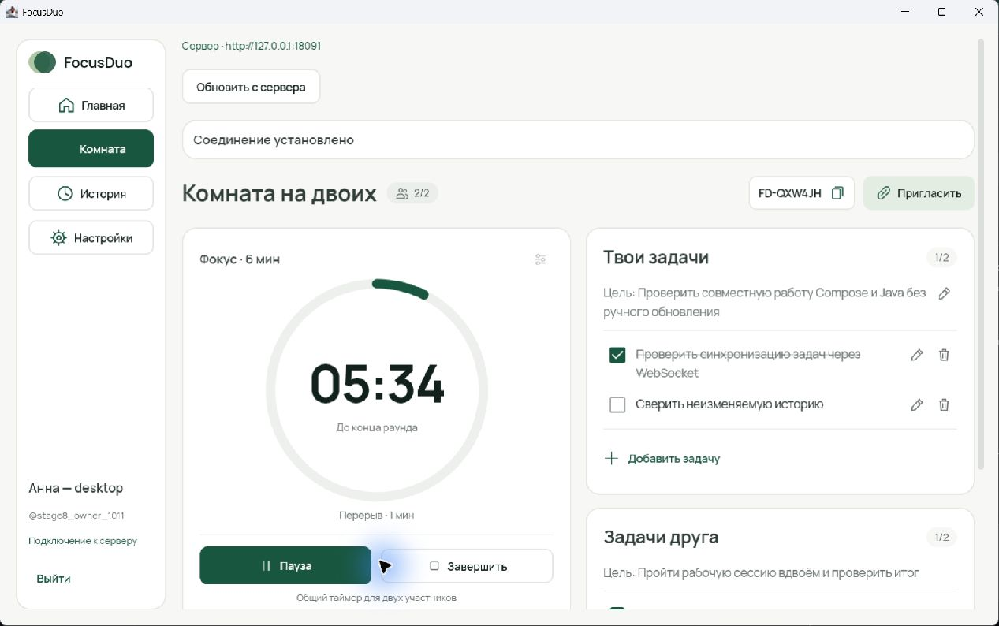
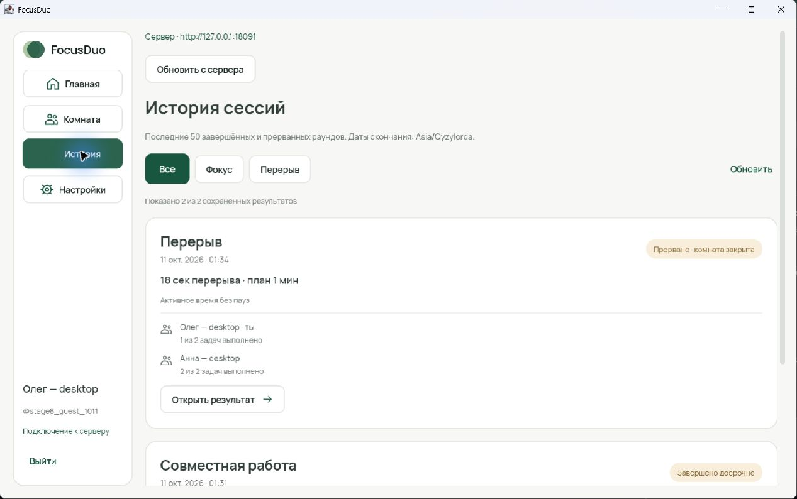
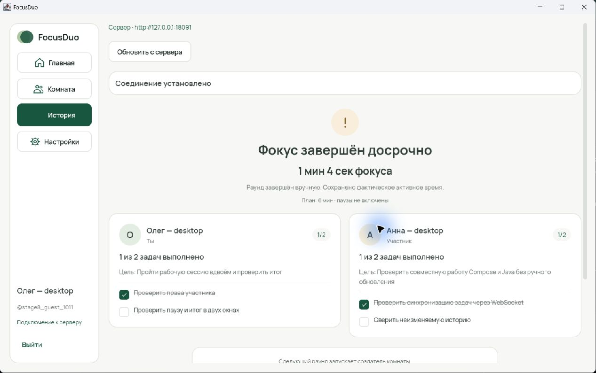
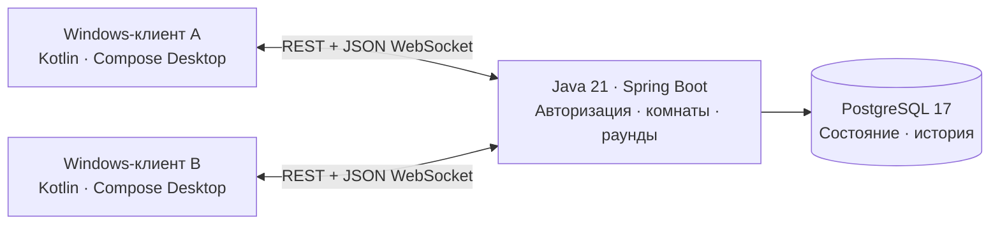

<div align="center">


# FocusDuo

**Один ритм. Две цели. Общий результат.**

Desktop-приложение для совместных рабочих сессий: приглашайте друга,
планируйте свои задачи и работайте с общим таймером.

<p>
  
  
  
  
  
</p>

[Возможности](#features) · [Интерфейс](#screenshots) · [Запуск](#quickstart) · [Работа вдвоём](#together) · [Архитектура](#architecture) · [Документация](#docs)

</div>

---

FocusDuo помогает выделить время на конкретную работу и провести его вместе — за учёбой, личным проектом или повседневными задачами. У каждого участника своя цель и список дел, у комнаты — общий ритм: **фокус → итог → перерыв**.

Изменения появляются у партнёра автоматически. После сессии остаётся история с фактическим временем работы и сохранёнными результатами обоих участников.

> **Статус:** сервер и desktop-клиент реализованы; совместная работа на двух компьютерах через Tailscale прошла [ручную проверку](docs/backend/REMOTE_ACCEPTANCE_2026-10-12.md). Сейчас приложение запускается из исходников. Windows-установщик со встроенной Java — [следующий этап](docs/backend/WINDOWS_PACKAGING_HANDOFF.md); файл для скачивания пока не опубликован.

<a id="features"></a>

## Что можно делать

| Возможность | Как это работает |
| --- | --- |
| **Комната на двоих** | Создайте комнату и передайте код другу. Каждый входит в свой аккаунт на одном сервере. |
| **Личные цели и задачи** | Запишите цель, добавьте дела, меняйте названия и отмечайте выполненное. Участники видят прогресс друг друга и редактируют только свои задачи. |
| **Общий таймер** | Создатель запускает FOCUS, ставит его на паузу, продолжает или завершает досрочно. Остаток времени синхронизируется с сервером. |
| **Отдельный перерыв** | После завершённого фокуса можно запустить BREAK. Длительности задаёт создатель; по умолчанию — 25 и 5 минут. |
| **Сохранённый результат** | Итог показывает активное время без пауз, цели и задачи обоих. Поздние правки задач не меняют прошедшую сессию. |
| **История сессий** | Последние 50 завершённых или прерванных раундов, фильтры по фокусу и перерывам, подробный итог каждого. |
| **Восстановление соединения** | При потере сети клиент сообщает о проблеме и синхронизируется после возвращения связи. После перезапуска приложения текущая комната восстанавливается при входе. |
| **Деморежим** | Познакомьтесь с интерфейсом без сервера: локальные сценарии с явной пометкой «Демо». |

Создатель управляет таймером и длительностями. Закрыть комнату для обоих может любой участник — с подтверждением. Простое закрытие приложения или выход из аккаунта комнату не закрывают.

<a id="screenshots"></a>

## Как выглядит FocusDuo

Светлый интерфейс с зелёными акцентами: таймер, свои задачи и задачи друга в одной комнате.



<table>
  <tr>
    <th>История сессий</th>
    <th>Итог рабочего раунда</th>
  </tr>
  <tr>
    <td></td>
    <td></td>
  </tr>
</table>

Скриншоты реального Compose-приложения из [проверки двух клиентов с Java backend](desktop/docs/STAGE8_1_INTEGRATION.md). Имена и задачи на них — тестовые; порт `18091` относится к тому стенду. Обычный локальный порт — `8090`.

<a id="quickstart"></a>

## Быстрый старт из исходников

### Что понадобится

| Сценарий | Требования |
| --- | --- |
| Посмотреть демо | Windows, Git и **JDK 21** |
| Подключить клиент к готовому серверу | Windows, Git, **JDK 21** и адрес сервера |
| Запустить собственный сервер | **JDK 21**, PostgreSQL 17; для приведённых команд — Docker с Linux containers и Compose v2 |

Maven и Gradle устанавливать отдельно не нужно: у каждой части есть свой wrapper. При первой сборке нужен интернет для загрузки зависимостей. Установленный в будущем Windows-пакет должен включать свой Java runtime — это проверяется на этапе упаковки.

Получите исходники:

```powershell
git clone https://github.com/KDvibers/FocusDuo.git
Set-Location FocusDuo
```

### Посмотреть интерфейс без сервера

Из корня репозитория:

```powershell
powershell -NoProfile -ExecutionPolicy Bypass -File .\desktop\run.ps1 -Demo
```

Деморежим работает в памяти одного приложения. Можно создать комнату, добавить демоучастника, пройти фокус и перерыв, посмотреть историю. Эти данные исчезнут после закрытия приложения и не отправляются на сервер.

### Запустить backend

Следующие команды предназначены для PowerShell с доступным Docker. Если Docker работает внутри WSL, используйте [отдельную инструкцию WSL](backend/README.md#запуск-в-wsl-при-отсутствии-docker-в-windows).

Из корня репозитория:

```powershell
# Создаёт .env со случайным паролем БД; существующий файл сохраняет.
powershell -NoProfile -ExecutionPolicy Bypass -File .\backend\scripts\init-local.ps1
if ($LASTEXITCODE -ne 0) { throw 'Не удалось подготовить .env' }

# Передаёт настройки из .env Java-процессу в этой оболочке.
Get-Content .env | ForEach-Object {
    if ($_ -match '^([A-Z][A-Z0-9_]*)=(.*)$') {
        [Environment]::SetEnvironmentVariable($matches[1], $matches[2], 'Process')
    }
}

docker compose up -d --wait db
if ($LASTEXITCODE -ne 0) { throw 'Не удалось запустить PostgreSQL' }
Set-Location backend
.\mvnw.cmd spring-boot:run
```

Оставьте сервер работать в этом терминале. При первом старте Flyway применит миграции. PostgreSQL хранит данные в отдельном Docker volume; перезапуск приложения не удаляет историю.

`.env` требуется только владельцу backend. Клиентам достаточно адреса сервера и собственных аккаунтов FocusDuo. Все переменные, запуск JAR, Bash/WSL и устранение проблем описаны в [backend/README.md](backend/README.md).

### Открыть клиент

В новом PowerShell, из корня репозитория:

```powershell
powershell -NoProfile -ExecutionPolicy Bypass -File .\desktop\run.ps1
```

Скрипт ищет JDK 21 в `FOCUSDUO_JAVA_HOME`, `JAVA_HOME`, пользовательской папке `.jdks` и `PATH`. Если JDK не найдена, укажите её каталог в `FOCUSDUO_JAVA_HOME`.

В приложении выберите адрес сервера, зарегистрируйтесь или войдите. Для локального backend адрес по умолчанию — **`http://127.0.0.1:8090`**. Пути `/api/v1` и `/ws/rooms/...` клиент добавляет сам.

<a id="together"></a>

## Первая совместная сессия

1. **Подключитесь к одному backend.** На разных компьютерах `127.0.0.1` означает разные машины. Для удалённой работы укажите общий HTTPS-адрес.
2. **Войдите в разные аккаунты.** Один участник создаёт комнату, второй входит по её коду.
3. **Запишите цели и задачи.** Списки личные, но видны обоим.
4. **Запустите фокус.** Создатель управляет общим раундом; партнёр видит актуальный таймер и изменения задач.
5. **Посмотрите результат.** После завершения итог сохранится в истории. Перерыв и следующий фокус запускаются вручную.

Для двух компьютеров в разных местах уже проверен маршрут **Tailscale → HTTPS/WSS → один Java backend**. Пошаговая [инструкция подключения](docs/backend/SERVER_CONNECTION.md) объясняет настройку адреса, запуск Serve и диагностику недоступного сервера.

**Сервер должен оставаться включённым.** Если backend работает на ноутбуке, его выключение или сон прерывают доступ для обоих. Windows-установщик клиента сам по себе не создаёт постоянно доступный сервер.

<a id="architecture"></a>

## Как это устроено



**Сервер хранит состояние, клиент отображает его.** REST выполняет команды, обычный JSON WebSocket доставляет полные снимки комнаты после фиксации изменений в БД. Секундный отсчёт клиент вычисляет по серверному сроку и монотонным часам; сервер не рассылает каждую секунду отдельное событие.

| Часть | Технологии |
| --- | --- |
| Backend | Java 21, Spring Boot 3.5, Spring Security, Spring Data JPA, Bean Validation |
| Хранение | PostgreSQL 17, Flyway, транзакции и ограничения БД |
| Desktop | Kotlin 2.2, Compose Desktop 1.9, Coroutines / StateFlow |
| Сеть | Ktor / CIO, kotlinx.serialization, REST и raw JSON WebSocket |
| Сборка | Maven Wrapper в `backend/`, Gradle Wrapper в `desktop/` |
| Проверки | JUnit 5, Testcontainers, контрактные fixtures, HTTP/WS smoke, GitHub Actions для backend |

Несколько решений, важных для совместной работы:

- **Повторы без дублей.** `Idempotency-Key` позволяет повторить тот же запрос после потери ответа, сохранив один результат операции.
- **Защита от устаревшего состояния.** `X-Room-Revision` проверяет версию комнаты; конфликт возвращает актуальный снимок для синхронизации.
- **Таймер переживает рестарт.** Сроки и активное время сохраняются в PostgreSQL. Просроченный раунд получает исходное время окончания и одну запись истории.
- **История неизменяема.** Завершённый результат содержит собственную копию целей и задач.
- **Явная авторизация.** Сервер выдаёт случайный bearer-токен и хранит его хеш. Пароли хешируются Argon2id; права проверяются на сервере.
- **Секреты остаются в памяти клиента.** На диск сохраняются адрес сервера и username. После перезапуска нужен повторный вход, затем восстанавливается текущая комната.

Точные DTO, маршруты и правила взаимодействия — в [контракте V1](docs/FOCUSDUO_CONTRACT_V1.txt) и [OpenAPI](docs/contracts/openapi.yaml).

## Проверки и воспроизводимость

Из `backend/`:

```powershell
.\mvnw.cmd test      # Unit-тесты и контрактные примеры
.\mvnw.cmd verify    # Также PostgreSQL Testcontainers; требуется Docker
```

Из `desktop/`, с JDK 21:

```powershell
.\gradlew.bat test check --console=plain
```

Обычные desktop-тесты используют модели, fixtures и тестовые транспорты. Живые проверки Java backend запускаются отдельно; команды и требования — в [desktop/README.md](desktop/README.md).

Сохранённые отчёты позволяют увидеть, **что проверялось и на какой версии**:

| Проверка | Отчёт |
| --- | --- |
| Серверные тесты, PostgreSQL и HTTP/WS smoke | [Backend: сборка и проверки](backend/README.md#сборка-и-проверки) · [CI workflow](.github/workflows/backend.yml) |
| Два реальных Compose-клиента с Java | [Обычный сценарий и права участников](desktop/docs/STAGE8_1_INTEGRATION.md) |
| Переподключение, восстановление и TTL | [Recovery / navigation](desktop/docs/STAGE8_2_RECOVERY.md) |
| FOCUS, истёкший при выключенном сервере | [Рестарт, итог и SQL-инварианты](docs/backend/EXPIRED_FOCUS_ACCEPTANCE.md) |
| Два компьютера через Tailscale | [Ручная удалённая проверка, 12.10.2026](docs/backend/REMOTE_ACCEPTANCE_2026-10-12.md) |

Это результаты отдельных прогонов, а не заявление о повторном выполнении всех проверок на каждом коммите. Ручной отчёт через Tailscale основан на сообщениях участников; проверки установщика в него не входят.

## Ближайший этап: приложение с установщиком

Совместный сценарий уже работает. Следующий шаг — довести доставку приложения до привычного Windows-формата:

- [ ] Финальная проверка интерфейса на сборке для упаковки.
- [ ] Реальный `.msi` или `.exe` со встроенным Java runtime.
- [ ] Иконка FocusDuo, ярлыки рабочего стола и меню «Пуск».
- [ ] Установка, запуск через ярлык и подключение к серверу без установленной Java или Gradle.
- [ ] Проверка удаления и повторной установки с сохранением серверной истории.

[Задание Kotlin-разработчику и критерии приёмки](docs/backend/WINDOWS_PACKAGING_HANDOFF.md). Публикация установщика — отдельный шаг после проверки пакета.

## Границы текущей версии

FocusDuo рассчитан на **двух участников в комнате** и один серверный процесс. У пользователя может быть одна открытая комната; для смены партнёра её нужно закрыть и создать новую. История возвращает последние 50 раундов без пагинации.

Встроенных звонков, чата и восстановления забытого пароля сейчас нет. Деморежим локальный; общая комната требует доступного backend. Для нескольких серверных экземпляров понадобится общая доставка WebSocket-событий.

<a id="docs"></a>

## Навигация по проекту

```text
FocusDuo/
├── backend/                 Java API, миграции, тесты и Maven Wrapper
├── desktop/                 Kotlin/Compose-клиент и Gradle Wrapper
├── docs/
│   ├── FOCUSDUO_CONTRACT_V1.txt
│   ├── contracts/           OpenAPI, HTTP-примеры и JSON fixtures
│   └── backend/             Интеграция, приёмка и передача
├── .github/workflows/       Backend CI
├── .env.example             Пример серверных настроек
└── compose.yaml             PostgreSQL для локального backend
```

| Задача | Документ |
| --- | --- |
| Запустить или настроить сервер | [Backend README](backend/README.md) |
| Разрабатывать desktop-клиент | [Desktop README](desktop/README.md) |
| Подключиться к общему серверу | [Подключение и диагностика](docs/backend/SERVER_CONNECTION.md) |
| Разобраться в API | [Контракт V1](docs/FOCUSDUO_CONTRACT_V1.txt) · [OpenAPI](docs/contracts/openapi.yaml) · [HTTP-примеры](docs/contracts/requests.http) |
| Проверить интеграцию | [HANDOFF](docs/backend/HANDOFF.md) · [Матрица проверок](docs/backend/INTEGRATION.md) |
| Подготовить Windows-пакет | [Этап упаковки](docs/backend/WINDOWS_PACKAGING_HANDOFF.md) |
| Посмотреть этапы разработки | [Backend](docs/backend/ROADMAP.md) · [Desktop](desktop/docs/ROADMAP.md) |

---

<div align="center">
<strong>Выберите цель. Пригласите друга. Начните вместе.</strong>
</div>
